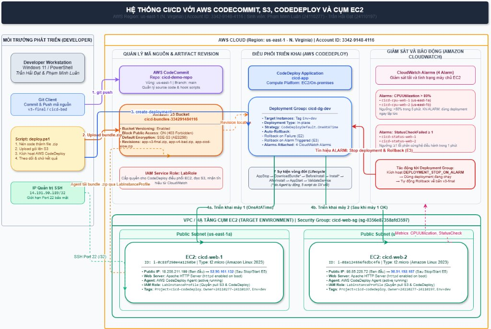

# CI/CD với AWS CodeCommit, Amazon S3, CodeDeploy và Cụm EC2

Dự án xây dựng quy trình triển khai ứng dụng web tự động (Continuous Deployment - CD) lên hai máy chủ Amazon EC2 bằng **AWS CodeCommit**, **Amazon S3** và **AWS CodeDeploy**, tích hợp giám sát thời gian thực với **Amazon CloudWatch Alarms** và cơ chế tự động **Rollback** khi xảy ra sự cố. Đến hết **Tuần 4**, nhóm đã hoàn thành toàn bộ các kịch bản kiểm thử (E1–E6), tối ưu chi phí, hoàn tất video demo và nghiệm thu đề tài.

---

## Thông tin đồ án

- **Môn học:** Điện toán đám mây
- **Giảng viên hướng dẫn:** TS. Huỳnh Xuân Phụng
- **Sinh viên thực hiện:**
  - Trần Hải Đạt – MSSV: `24110197`
  - Phạm Minh Luân – MSSV: `24110277`
- **AWS Region:** `us-east-1` (N. Virginia)
- **Account ID:** `3342-9148-4116`
- **Kho lưu trữ GitHub:** [CI-CD-voi-CodeCommit-va-CodeDeploy-len-nhom-EC2-AWS-](https://github.com/luanpm18/CI-CD-voi-CodeCommit-va-CodeDeploy-len-nhom-EC2-AWS-)

---

## Kiến trúc hệ thống tổng thể

Dưới đây là sơ đồ kiến trúc tổng thể toàn bộ hệ thống CI/CD được thiết kế và triển khai trên AWS:



### Các khối thành phần chính trong kiến trúc:

1. **Môi trường phát triển (Developer Workstation):**
   - Lập trình viên làm việc trên Windows / Visual Studio Code / PowerShell.
   - Quản lý mã nguồn bằng Git Client, đẩy code lên nhánh `main` của AWS CodeCommit.
   - Script tự động hóa `deploy.ps1`: tự động nén mã nguồn thành gói `.zip`, tải lên S3, kích hoạt CodeDeploy và theo dõi kết quả.
   - Kết nối SSH quản trị an toàn tới EC2 thông qua IP cố định `14.191.90.189/32`.

2. **Quản lý mã nguồn & Lưu trữ Revision:**
   - **AWS CodeCommit (`cicd-demo-repo`):** Lưu trữ mã nguồn ứng dụng web và các bash script lifecycle hooks.
   - **Amazon S3 (`cicd-bundles-334291484116`):** Lưu trữ các gói revision (`app-v3-final.zip`, `app-v4-bad.zip`, `app-cicd-slow.zip`). Bật tính năng **Bucket Versioning**, **Block all public access** (HTTP 403 Forbidden) và mã hóa mặc định **SSE-S3 (AES256)**.
   - **IAM Service Role (`LabRole`):** Trao quyền cho CodeDeploy điều phối EC2, đọc gói zip từ S3 và nhận tín hiệu cảnh báo từ CloudWatch.

3. **Điều phối triển khai (AWS CodeDeploy):**
   - **Application:** `cicd-app` (nền tảng EC2/On-premises).
   - **Deployment Group:** `cicd-dg-dev` lọc theo tag `Env=dev`.
   - **Chiến lược:** `CodeDeployDefault.OneAtATime` (triển khai tuần tự từng máy một để giảm thiểu rủi ro).
   - **Cơ chế Rollback:** Bật tự động Rollback khi deployment thất bại (`DEPLOYMENT_FAILURE`) hoặc khi alarm kích hoạt (`DEPLOYMENT_STOP_ON_ALARM`).

4. **Giám sát & Báo động (Amazon CloudWatch):**
   - 4 Metric Alarms gắn trực tiếp vào Deployment Group:
     - `cicd-cpu-web-1`, `cicd-cpu-web-2`: Báo động khi `CPUUtilization > 80%` trong 5 phút.
     - `cicd-status-web-1`, `cicd-status-web-2`: Báo động khi `StatusCheckFailed >= 1` trong 1 phút.
   - Khi có alarm chuyển sang `ALARM`, CodeDeploy lập tức dừng deployment (`Stopped`) và kích hoạt Rollback về phiên bản an toàn trước đó.

5. **Hạ tầng Cụm EC2 (Target Environment):**
   - Cụm 2 máy chủ EC2 nằm trên 2 Availability Zones khác nhau nhằm tăng tính sẵn sàng:
     - `cicd-web-1` (`i-0c88f250e4a1250be`) tại Subnet `us-east-1a`.
     - `cicd-web-2` (`i-08a124556f6dbc4f6`) tại Subnet `us-east-1b`.
   - Cấu hình chung: Amazon Linux 2023, loại máy `t2.micro`, ổ cứng 8 GB gp3, chạy dịch vụ Apache HTTP Server (`httpd` tự khởi động cùng hệ thống), CodeDeploy Agent luôn active.
   - **Security Group (`cicd-web-sg`):** Giới hạn cổng SSH (22) chỉ cho IP quản trị `14.191.90.189/32`, cổng HTTP (80) mở công khai `0.0.0.0/0`.
   - **Tag chuẩn:** `Project=cicd-codedeploy`, `Owner=24110277-24110197`, `Env=dev`.

---

## Tiến độ thực hiện qua các tuần

| Tuần | Thời gian | Công việc và kết quả đạt được |
| :---: | :---: | :--- |
| **1** | 05/10 – 11/10/2026 | Nghiên cứu lý thuyết CI/CD, thiết kế kiến trúc, khởi tạo cụm 2 EC2 (`cicd-web-1`, `cicd-web-2`), gán tag chuẩn và cài đặt CodeDeploy Agent. |
| **2** | 12/10 – 18/10/2026 | Tạo S3 Bucket có versioning, tạo CodeCommit repo, viết `appspec.yml` cùng 5 lifecycle hook scripts, thiết lập CodeDeploy `cicd-dg-dev` (OneAtATime) và triển khai Version 1 thành công. |
| **3** | 19/10 – 25/10/2026 | Triển khai Version 2; tạo 4 CloudWatch Alarm; kiểm thử kịch bản rollback khi bản lỗi và dừng deployment khi alarm kích hoạt; siết chặt bảo mật S3 và SSH. |
| **4** | 26/10 – 01/11/2026 | **Kiểm thử tổng thể E1–E6**; triển khai **Version 3 (FINAL)**; vẽ sơ đồ kiến trúc Draw.io; rà soát chi phí (Used $1.4); sản xuất **Video Demo nghiệm thu ($\le$ 10 phút)** và lập quy trình dọn dẹp hạ tầng an toàn. |

---

## Vòng đời triển khai In-place (Lifecycle Hooks)

Quy trình triển khai của CodeDeploy Agent trên từng máy chủ EC2 diễn ra tuần tự qua 7 sự kiện vòng đời:

```text
[1. ApplicationStop]       ──► Dừng Apache httpd hiện tại (scripts/stop_server.sh)
        │
[2. DownloadBundle]        ──► Agent tự động tải gói revision .zip từ S3 xuống EC2
        │
[3. BeforeInstall]         ──► Cài đặt httpd (nếu thiếu) và dọn sạch thư mục web (scripts/before_install.sh)
        │
[4. Install]               ──► Agent giải nén và chép mã nguồn từ revision vào /var/www/html/
        │
[5. AfterInstall]          ──► Phân quyền apache:apache, chmod 755, ghi log deploy (scripts/after_install.sh)
        │
[6. ApplicationStart]      ──► Khởi động và bật tự chạy Apache httpd (scripts/start_server.sh)
        │
[7. ValidateService]       ──► Gửi curl localhost quét chuỗi 'STATUS: healthy' (scripts/validate_service.sh)
                                • Tìm thấy: exit 0 ──► Deployment Thành công (Succeeded)
                                • Sau 5 lần không thấy: exit 1 ──► Kích hoạt Tự động Rollback
```

> ⚠️ **Lưu ý then chốt:** Chuỗi `STATUS: healthy` trong file HTML là điều kiện bắt buộc để `validate_service.sh` trả về `exit 0`. Nếu chuỗi này bị thay đổi hoặc server không phản hồi đúng, CodeDeploy sẽ đánh dấu lỗi và lập tức rollback.

---

## Kết quả kiểm thử tổng thể (Tuần 4)

Bảng tổng hợp kết quả 6 kịch bản kiểm thử toàn diện thực hiện trong Tuần 4 (ngày 30/10/2026):

| Mã | Kịch bản kiểm thử | Trạng thái CodeDeploy | Thời gian | Bản phục vụ sau cùng | Ý nghĩa kỹ thuật |
| :---: | :--- | :---: | :---: | :---: | :--- |
| **E1** | **Chu trình đầy đủ:** Sửa code $\rightarrow$ CodeCommit $\rightarrow$ `deploy.ps1` | **Succeeded** (2/2 máy) | 6–7s / máy | Version 3 (FINAL) | Quy trình CD chuẩn hoạt động trơn tru, web cập nhật tức thời trên cả 2 IP. |
| **E2** | **Bản lỗi (`cicd-bad`):** Hook `ValidateService` cố tình sai chuỗi kiểm tra | **Failed** $\rightarrow$ Rollback **Succeeded** | ~1.5 phút | Version 3 (FINAL) | Máy 1 lỗi, máy 2 Skipped (`OneAtATime`); CodeDeploy tự rollback về bản v3 an toàn. |
| **E3** | **Alarm kích hoạt khi đang deploy:** Ép alarm CPU lên `ALARM` bằng CloudShell | **Stopped** $\rightarrow$ Rollback **Succeeded** | Dừng ngay lập tức | Version 3 (FINAL) | Nhận diện tín hiệu alarm thời gian thực, dừng triển khai khẩn cấp để tránh sập cụm EC2. |
| **E4** | **Redeploy cùng revision:** Deploy lại gói `app-v3-final.zip` đã có trên S3 | **Succeeded** (2/2 máy) | 6–7s / máy | Version 3 (FINAL) | Kiểm chứng tính tái sử dụng và khả năng chạy lặp lại nhiều lần của pipeline. |
| **E5** | **Stop / Start EC2:** Tắt 2 máy rồi bật lại, Public IP thay đổi | Không cần deploy lại | ~2–3 phút hồi phục | Version 3 (FINAL) | `httpd` tự chạy nhờ `systemctl enable`; Agent tự kết nối lại; chứng minh tính bền vững. |
| **E6** | **Kiểm tra bảo mật:** Thử truy cập S3 qua internet & kiểm tra Security Group | HTTP 403 Forbidden | – | Version 3 (FINAL) | S3 khóa chặn hoàn toàn truy cập công khai; SSH giới hạn duy nhất IP quản trị `/32`. |

---

## Cấu trúc thư mục Repository

```text
.
├── Bao Cao Tien Do/                    # Báo cáo tiến độ chi tiết Word & PDF theo từng tuần
│   ├── Bao Cao Tien Do Tuan 1.pdf
│   ├── BaoCaoTienDoTuan2DienToanDamMay.pdf
│   ├── BaoCaoTienDoTuan3DienToanDamMay.pdf
│   └── BaoCaoTienDoTuan4.docx          # Báo cáo tổng kết Tuần 4
├── cicd-demo-repo/                     # Mã nguồn PRODUCTION triển khai thực tế
│   ├── appspec.yml                     # Cấu hình trung tâm cho AWS CodeDeploy Agent
│   ├── src/
│   │   └── index.html                  # Giao diện web hiển thị Version 3 (FINAL)
│   └── scripts/                        # 5 Bash scripts tương ứng với 5 Lifecycle Hooks
│       ├── stop_server.sh              # ApplicationStop
│       ├── before_install.sh           # BeforeInstall
│       ├── after_install.sh            # AfterInstall
│       ├── start_server.sh             # ApplicationStart
│       └── validate_service.sh         # ValidateService (quét STATUS: healthy)
├── cicd-bad/                           # Fixture CỐ TÌNH LỖI để kiểm thử cơ chế Rollback
│   ├── appspec.yml
│   ├── src/index.html
│   └── scripts/validate_service.sh     # Luôn trả về exit 1 (tìm STATUS: BROKEN)
├── docs/                               # Tài liệu thiết kế & sơ đồ kiến trúc
│   ├── KienTrucTongThe.drawio          # File thiết kế sơ đồ kiến trúc trên Draw.io
│   ├── KienTrucTongThe.png             # Hình ảnh sơ đồ kiến trúc xuất chất lượng cao
│   └── Quy uoc Tags.md                 # Quy chuẩn gắn nhãn tài nguyên AWS
├── BaoCaoCongViecTuan4.md              # Báo cáo tổng hợp công việc Tuần 4 dạng Markdown
├── deploy.ps1                          # Script PowerShell tự động hóa đóng gói và kích hoạt deploy
├── WORKLOG.md                          # Nhật ký công việc và giờ làm chi tiết của từng sinh viên
└── README.md                           # Tài liệu tổng quan đề tài
```

---

## Hướng dẫn đóng gói và triển khai thủ công

Các lệnh dưới đây thực hiện trong **PowerShell** tại thư mục gốc repository:

```powershell
# 1. Khai báo tên bucket đã cấu hình
$BucketName = "cicd-bundles-334291484116"

# 2. Đóng gói mã nguồn thành file zip với appspec.yml ở thư mục gốc
Push-Location .\cicd-demo-repo
Compress-Archive -Path .\appspec.yml, .\src, .\scripts -DestinationPath ..\app-v3-final.zip -Force
Pop-Location

# 3. Tải revision lên Amazon S3
aws s3 cp .\app-v3-final.zip "s3://$BucketName/app-v3-final.zip" --region us-east-1

# 4. Kích hoạt AWS CodeDeploy triển khai lên Deployment Group
aws deploy create-deployment `
  --application-name cicd-app `
  --deployment-group-name cicd-dg-dev `
  --s3-location "bucket=$BucketName,key=app-v3-final.zip,bundleType=zip" `
  --region us-east-1
```

> 💡 **Khuyên dùng:** Bạn có thể dùng script có sẵn `.\deploy.ps1 -Name app-v3-final` để tự động hóa toàn bộ 4 bước trên chỉ với 1 câu lệnh duy nhất.

---

## Chi phí và Tối ưu hóa tài nguyên

- **Credit thực tế trên Learner Lab:** **Used $1.4 of $50** (chi phí cả khóa học chỉ chiếm 2.8% ngân sách được cấp).
- **Chi phí phát sinh Tuần 4:** Xấp xỉ $0.00 USD.
- **Biện pháp tối ưu đã áp dụng:**
  - Luôn `Stop` máy chủ EC2 sau mỗi buổi làm việc để tránh phát sinh chi phí tính giờ On-Demand.
  - Sử dụng cấu hình `t2.micro` và ổ đĩa 8 GB gp3 vừa vặn cho nhu cầu chạy web server Apache.
  - Không sử dụng các dịch vụ có chi phí duy trì cao như Application Load Balancer (ALB), NAT Gateway hay Elastic IP.
  - Giữ số lượng CloudWatch Alarm là 4 (nằm trọn trong Free Tier 10 alarm tiêu chuẩn mỗi tháng).

---

## Video Demo & Báo cáo đề tài

- **Link Video Demo (YouTube / Google Drive):** https://youtu.be/dkLdsP9fIHs / https://drive.google.com/drive/folders/1mei0B_mjRlydAkb_a3_3tgatSokdC2xK?usp=sharing *(Thời lượng: 8:53, Full HD 720p)*
- **Báo cáo tiến độ đầy đủ:** [BaoCaoTienDoTuan4.docx](./Bao%20Cao%20Tien%20Do/BaoCaoTienDoTuan4.docx)
- **Sơ đồ thiết kế Draw.io:** [KienTrucTongThe.drawio](./docs/KienTrucTongThe.drawio)
- **Nhật ký công việc cá nhân:** [WORKLOG.md](./WORKLOG.md)

---
##Minh chứng đã xóa EC2, S3 và SG
- Terminate EC2: 

- Xóa S3: 

- Xóa security group: 
